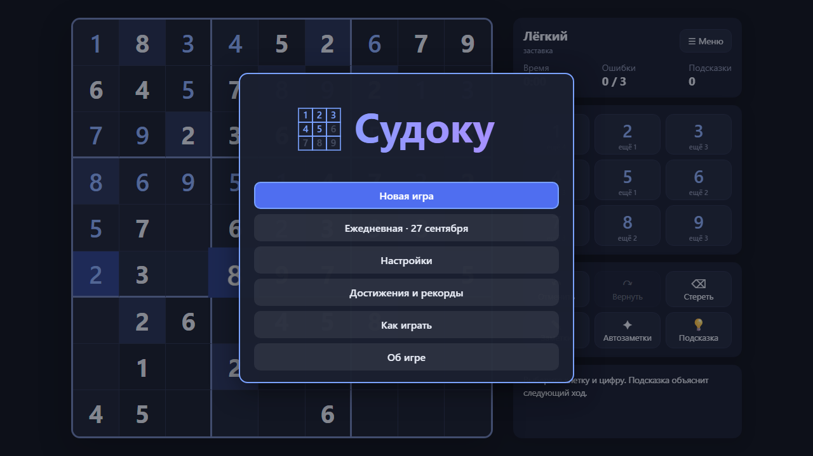
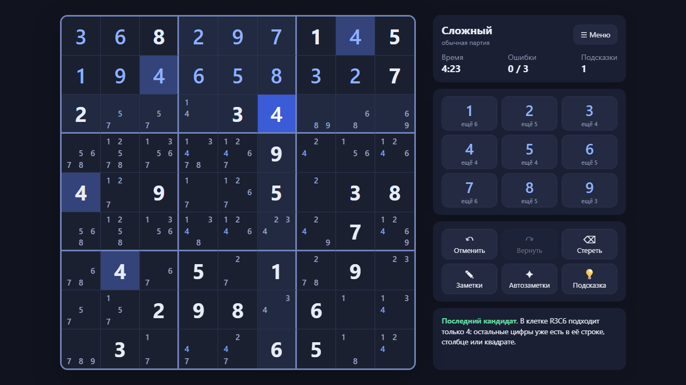
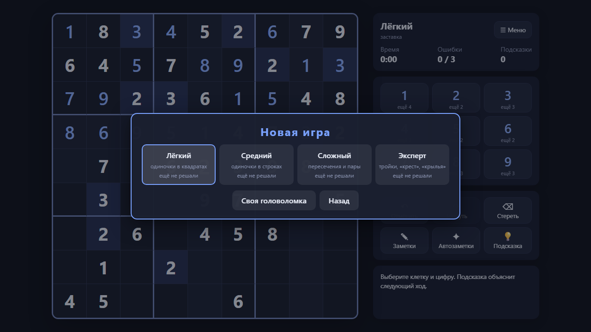

<div align="center">

# SudokuGame - Судоку

**Судоку на одной HTML-странице: четыре уровня по приёмам решения, подсказки с объяснением приёма, заметки, пауза и рекорды. Работает в браузере без сервера и без интернета: откройте `index.html` или играйте онлайн.**

[**▶ Играть онлайн →**](https://alexalesha.github.io/SudokuGame/) &nbsp;·&nbsp; [English version of this file](README.md)

[](#) [](LICENSE) [](https://developer.mozilla.org/docs/Web/HTML) [](https://alexalesha.github.io/SudokuGame/) [](https://claude.com/claude-code)

Код, тесты и документация этого проекта написаны Claude (Anthropic) в Claude Code. Идеи, проверка и решения - Алексей.

</div>







## Что есть в игре

- Головоломки строятся в самой странице: решатель на битовых масках проверяет, что решение одно, логический решатель определяет уровень человеческими приёмами.
- Уровни: Лёгкий (последний кандидат, одиночка в квадрате), Средний (скрытые одиночки), Сложный (пересечения, пары), Эксперт (тройки, «крест», «крылья»).
- Подсказка ставит одну цифру и объясняет приём; если на поле ошибка - сначала покажет её.
- Заметки и автозаметки, отмена и повтор, ежедневная головоломка - одна на всех в этот день, рекорды по уровням, геймпад.

## Управление

| Клавиша | Действие |
|---|---|
| Щелчок или стрелки, затем цифра | заполнить клетку |
| N / Q | заметки / автозаметки |
| Backspace | стереть |
| Ctrl+Z / Ctrl+Y | отмена / повтор |
| H | подсказка |

Где игра это позволяет, клавиши меняются в настройках.

## Запуск у себя

Откройте `index.html` в Chrome, Edge или Firefox. Всё лежит в репозитории, ничего не скачивается.

## Проверки

Законы - проверки Playwright в `tests/`. Они открывают страницу по файловому адресу в безголовом
Chromium, по одной за раз:

```
npm install
npx playwright install chromium
npm test
```

Захват мыши в проверках всегда поддельный: настоящий `requestPointerLock` в безголовом Chromium
на Windows может зажать курсор пользователя.
Кадры выше сняты в безголовом браузере скриптом кадров сборника Hub.

## История

Игра сделана в сборнике [Hub](https://github.com/ALEXalesha/ALEXalesha.github.io) (папка `web/sudoku`), там она же работает в Хабе ([играть там](https://alexalesha.github.io/)). Здесь игра лежит вместе с историей коммитов.

## Лицензия

MIT, см. [LICENSE](LICENSE).
